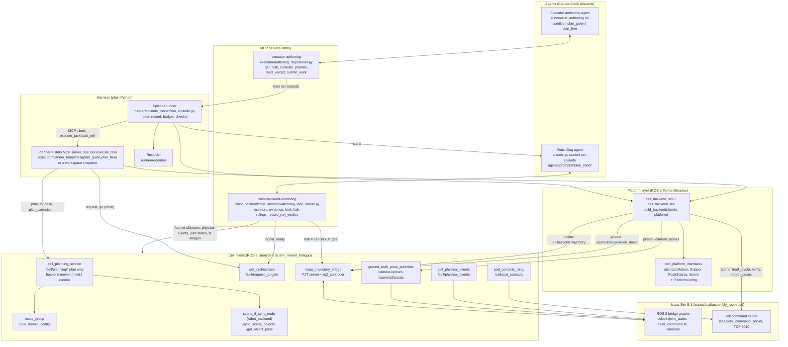
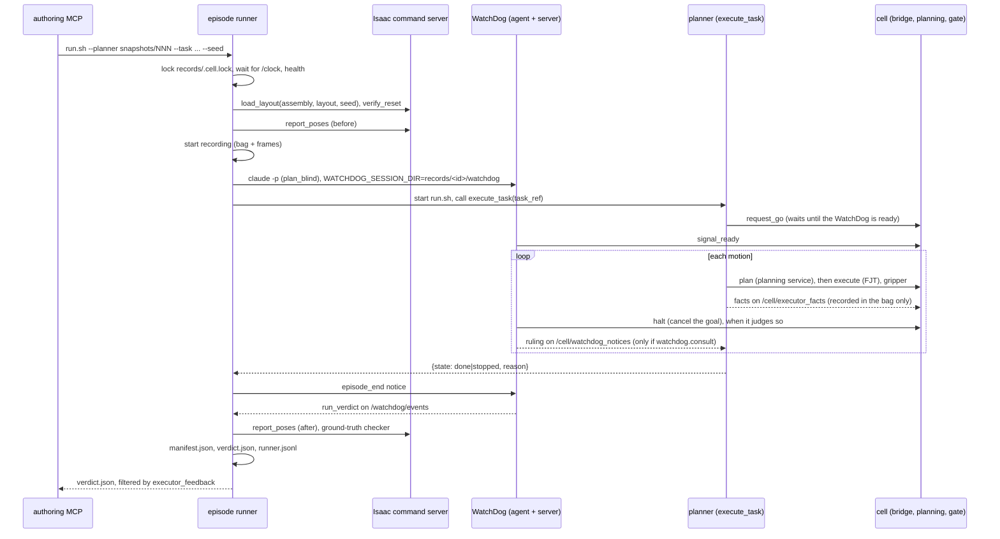
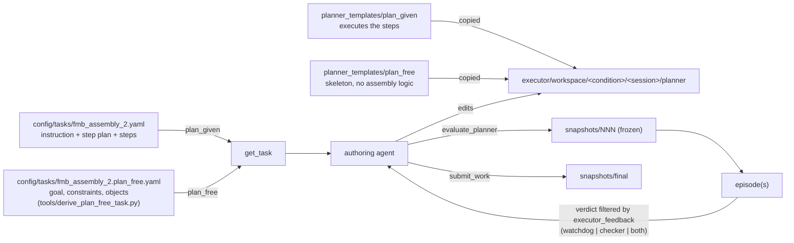

# Architecture

Written 2026-11-23 (Milestone 7). How the code and files connect, from the
simulator and ROS 2 up to the two agents. Diagrams are Mermaid (they render on
GitHub and in VS Code's Markdown preview with Mermaid support).

Two agents never talk to each other:

- the **executor** side: an authoring agent writes a *planner* (a program), and
  the episode runner runs that planner on the cell;
- the **WatchDog**: an agent that watches each episode through its own MCP
  server and judges it against the requirements.

Everything between them and the robot is ROS 2, and every ROS name comes from
`config/platforms/<platform>.yaml` (sim or hardware).

## 1. Layers



Read it bottom up:

1. **Isaac Sim** runs the stage. Its OmniGraph ROS 2 bridge publishes
   `/clock`, `/joint_states`, `/tf` and camera images, and takes
   `/joint_command`. The **cell command server** is a loopback TCP server
   inside Kit: layout reset, pose reports, contact reports, timeline.
2. **Cell nodes** turn that into the cell's services:
   - `isaac_trajectory_bridge`: the arm's FollowJointTrajectory action, and the
     RG2 controller (open/close/guarded move);
   - `cell_planning_service`: planning only, it never moves the arm. MoveIt
     today; cuRobo via `cell_planning_curobo` once installed;
   - `cell_orchestrator`: the start gate;
   - `cell_physical_events`: lifted, released, contact and stationarity events
     from the cell's own signals;
   - `ground_truth_pose_publisher`: on sim, camera1 and camera2 poses from
     Isaac TF;
   - `scene_tf_sync_node`: pushes registry geometry into the MoveIt scene.
3. **Platform layer**: `cell_platform_interfaces` defines the backend
   interfaces and reads the platform config. `cell_backend_sim` and
   `cell_backend_hw` implement them. `build_backends(node, platform)` returns
   motion, gripper, executor_poses, watchdog_poses and scene. The planner and
   the runner use the same backends, so they run unchanged on sim and
   hardware.
4. **Harness**: the episode runner owns one episode. It starts the planner as
   an MCP server and calls `execute_task` once.
5. **Agents** only ever touch MCP tools. The authoring agent edits planner
   files and calls `evaluate_planner`. The WatchDog agent calls its monitoring
   and judging tools.

## 2. One episode



The sim budget and the wall guard are enforced by the runner: when either is
exceeded it cancels the arm's goal and stops the call.

## 3. The authoring loop and its two conditions



| | `plan_given` | `plan_free` |
|---|---|---|
| Task file | full | goal, constraints, objects; plan references redacted |
| Template | runs the steps | gate, safe pose, halt handling, primitives; stops |
| Settings | `config/settings/executor.<platform>.settings.json` | `...plan_free.settings.json` (also denies every place the plan is written) |

Both templates share `executor/planner_templates/common/`: `run.sh`, the MCP
`server.py`, `worker.py` (the ROS side) and `geometry.py`.

## 4. What each agent can reach

| | Authoring agent | WatchDog agent |
|---|---|---|
| Tools | `executor-authoring` MCP only (`--strict-mcp-config`) | `robot-backend-watchdog` MCP only |
| Files | Read: executor-side config and sources. Edit: `executor/workspace/` only. No shell. | No Read, Glob, Grep or Bash at all |
| Task | `config/tasks/...` via `get_task` | `config/requirements/<assembly>.yaml` (no steps; refused if it has any) |
| Part data | `config/parts/executor_parts.yaml` (geometry, grasp force) | `config/parts/watchdog_parts.yaml` (tolerances, limits) |
| Poses | camera1 (`/camera1/poses`) through the planner | camera2 (`/camera2/poses`); camera1 only as a flagged cue |
| Outcome of an episode | `read_verdict`, filtered by `executor_feedback` | its own run verdict |
| Never | `records/`, `agents/`, WatchDog code and config | the executor's task, planner, facts as evidence, `records/` |

See `docs/INDEPENDENCE.md` for each channel and where it is cut.

## 5. Where things live

| Path | What | Used by |
|---|---|---|
| `config/platforms/{sim,hardware}.yaml` | every topic, service, action, frame and joint name | all ROS code, via `cell_platform_interfaces.platform_config` |
| `config/cell.yaml` | planner backend, budgets, WatchDog mode/consult, `executor_feedback`, recording | runner, planning service, WatchDog server, authoring MCP |
| `config/tasks/` | executor task files (full and plan-free) | planner, authoring MCP |
| `config/requirements/` | what the WatchDog judges against | WatchDog server, runner's checker |
| `config/parts/` | executor and WatchDog part data, generated from `robot_backend/config/model_registry.yaml` by `tools/split_registry.py` | planner; WatchDog; checker |
| `config/layouts/<assembly>/` | reset poses per layout | Isaac command server |
| `config/mcp/`, `config/settings/` | per-role MCP configs and permissions | `run_authoring.sh`, `run_episode.py`, `run_watchdog.sh` |
| `agents/` | WatchDog prompt templates and agent config; `agent_harness/` renders them | `role_context.py` in the WatchDog server |
| `executor/` | `authoring_mcp/`, `planner_templates/`, `workspace/` (ignored) | authoring sessions |
| `runner/` | episode runner, recorder, launch scripts, `jsonl.py` | everything that writes `records/` |
| `isaac/` | Kit-side code: command server, headless launch, camera setup | Isaac Sim |
| `ros2_ws/src/` | the ROS packages in section 1, plus descriptions (`robot_description`, `onrobot_rg_description`, `ur5e_moveit_config`) and `sim_moveit_bringup` (the sim launch) | the cell |
| `tools/` | `pick_check.py`, `split_registry.py`, `derive_plan_free_task.py` | by hand |
| `records/` (ignored) | episode records | runner, authoring MCP |

## 6. Records

Everything is JSON or JSON Lines (one object per line).

```
records/<episode_id>/
  manifest.json            inputs hashed, planner tree hash, git state, versions
  verdict.json             planner result, budget use, checker, WatchDog verdict, outcome
  runner.jsonl             runner events: episode_start, stage, planner_result, episode_end
  recording.json           what was recorded
  bag/  frames/            rosbag (mcap) and camera frames
  bag.stderr.jsonl  frames.stderr.jsonl
  executor/planner.jsonl         the planner's log
  executor/planner.stderr.jsonl  the planner process's raw stderr
  watchdog/                WatchDog session dir, transcript.jsonl, agent_config_watchdog.json
records/authoring/<session>/
  agent_config.json  session.json  evals.jsonl
records/pick_check/<stamp>.json
```

## 7. Where the v1 robot_backend pieces went

| v1 (WatchDog_V1 `robot_backend`) | v2 |
|---|---|
| motion/gripper/scene MCP servers that an LLM executor called | the planner's `worker.py` calling backends directly; the LLM writes the planner instead of driving the arm |
| `ros_moveit_backend/motion.py`: plan and execute through MoveGroup | plan: `cell_planning_service` (MoveIt or cuRobo); execute: `cell_backend_sim` FollowJointTrajectory to the bridge |
| `ros_moveit_backend/gripper.py`, `skills/gripper_skills.py` | `cell_backend_sim/gripper.py` (same RG2 controller); guarded grasp rule in `planner_templates/common/geometry.py` |
| `interfaces/*` | `cell_platform_interfaces` |
| `cell/gate.py` | the planner's `Worker.gate()` calling `cell_orchestrator` |
| poses through TF / `/get_object_pose` | `/camera1/poses` (executor) and `/camera2/poses` (WatchDog) |
| WatchDog: `watchdog/*`, `watchdog_mcp_server`, `events`, `registry`, `contracts`, `vision` | kept in `robot_backend`, made plan-blind in Milestone 5 |
| `nodes/scene_tf_sync_node.py`, `utils/geometry.py`, `utils/rg2_geometry.py` | kept |

The executor modules were deleted in Milestone 7 (`docs/PROVENANCE.md`).
